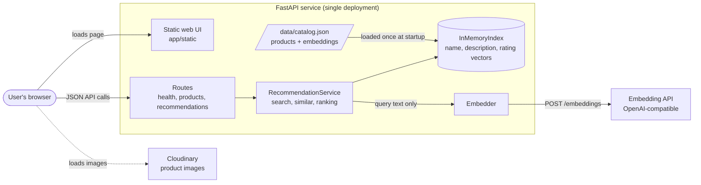
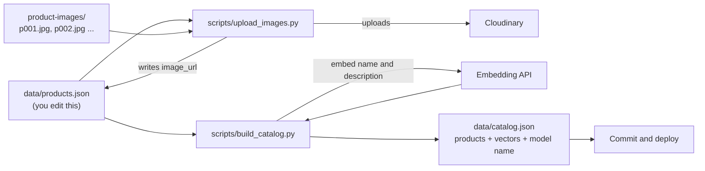
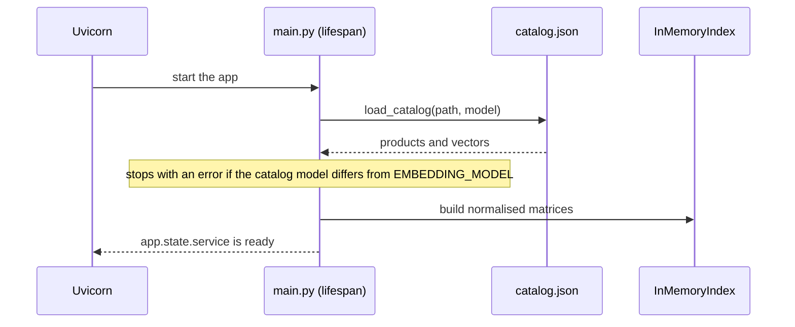
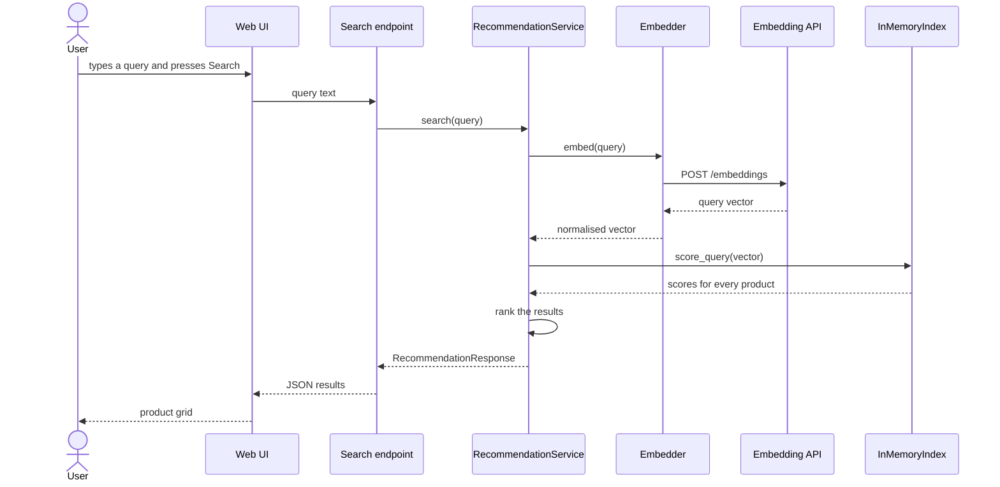
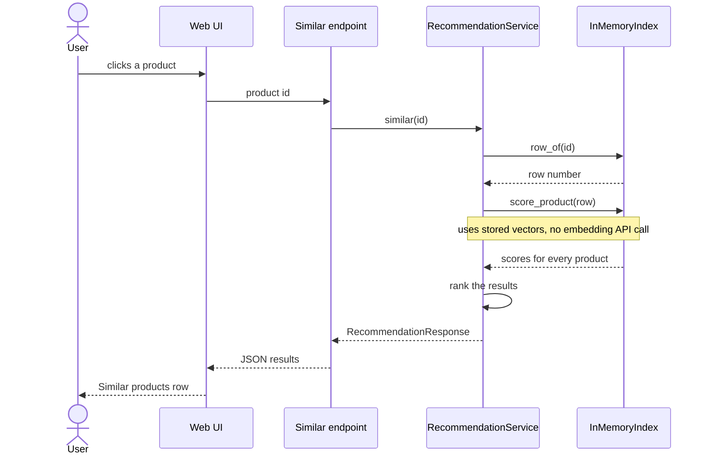
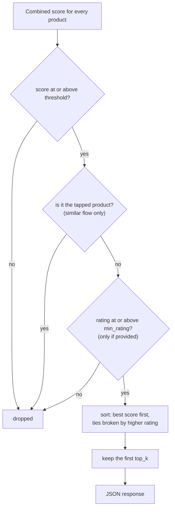

# Product Recommendation Service

A FastAPI backend and a small web UI that recommend products using text embeddings and cosine similarity.

- **Search by meaning.** Type "something for working out at home" and get fitness products, even if those exact words appear nowhere in the catalogue.
- **Similar products.** Tap a product and get related ones, with the tapped product itself excluded.
- **Simple and fast.** Product vectors are computed once and held in memory, so a similar-products request makes no external API call.

[**Live demo**](https://ai-powered-product-recommendation-system-production.up.railway.app/)

## Preview

<p align="center">
  
  <br>
</p>


## Contents

1. [How it works](#how-it-works)
2. [Architecture](#architecture)
3. [Data pipeline](#data-pipeline-offline)
4. [Request workflows](#request-workflows)
5. [Scoring](#scoring)
6. [API reference](#api-reference)
7. [Project structure](#project-structure)
8. [Getting started](#getting-started)
9. [Configuration](#configuration)
10. [Updating the catalogue](#updating-the-catalogue)
11. [Deployment](#deployment)
12. [Design decisions and limitations](#design-decisions-and-limitations)
13. [License](#license)

## How it works

Every product has three vectors, and similarity between two items is the cosine of the angle between their vectors.

| Vector | Built from | Source |
|---|---|---|
| Name | product name | embedding API, computed once offline |
| Description | product description | embedding API, computed once offline |
| Rating | the rating number (1 to 5) | small deterministic encoding, computed at startup |

Ratings are encoded with a smooth bucket function instead of a text model, because language models represent numbers like 4.5 and 4.4 poorly. All vectors are scaled to length 1, so cosine similarity becomes a plain dot product, and one matrix multiplication scores the whole catalogue at once. Search is an **exact brute-force search**: every query is compared with every product in one matrix multiplication, with no approximate index. It is fast at this size and always returns the true closest products.

## Architecture

The embedding vectors are generated ahead of time and stored in `data/catalog.json`. At startup the service loads that file into memory. A single deployment serves both the API and the web UI.



| Component | File | Responsibility |
|---|---|---|
| Routes | `app/routes/` | HTTP endpoints and input validation |
| Service | `app/service.py` | Loads the catalogue, runs search and similar flows, ranks results |
| Index | `app/index.py` | Holds the vector matrices and computes cosine scores |
| Embedder | `app/embeddings.py` | Calls the embedding API with batching and retries |
| Config | `app/config.py` | Settings read from environment variables |
| Web UI | `app/static/` | Plain HTML, CSS and JavaScript, served by the same app |

## Data pipeline (offline)

These two scripts run on your computer, not on the server. Their output, `data/catalog.json`, is committed and deployed with the code.



The catalogue records which embedding model produced the vectors. At startup the service refuses to run if that differs from `EMBEDDING_MODEL`, because vectors from different models cannot be compared.

## Request workflows

### Startup



### Search by text

One embedding API call is made per search: the user's query.



### Similar products (tap a product)

No external call is made: the tapped product's stored vectors are reused.



### Ranking

Both flows end with the same ranking step.



## Scoring
Each score is a weighted average of per-field cosine similarities. The weights are normalised, so they do not need to add up to 1.

**Search by text.** A text query can only be compared with text fields:

```
score = (w_name * name_sim + w_description * description_sim) / (w_name + w_description)
```

**Similar products.** The tapped product has all fields, so all of them count:

```
score = (w_name * name_sim + w_description * description_sim
         + w_rating * rating_sim + w_category * same_category) / (sum of weights)
```

`same_category` is 1 if the candidate has the same category as the tapped product, and 0 otherwise. It is a bonus and not a filter, so strongly related products from another category can still appear.

| Setting | Suggested | Effect |
|---|---|---|
| `WEIGHT_NAME` | 0.30 | Brand and product-name similarity |
| `WEIGHT_DESCRIPTION` | 0.45 | The most informative field |
| `WEIGHT_RATING` | 0.05 | A small nudge, since ratings say little about similarity |
| `WEIGHT_CATEGORY` | 0.20 | Keeps recommendations in the same category |
| `DEFAULT_THRESHOLD` | about 0.32 | Minimum score for text search |
| `DEFAULT_SIMILAR_THRESHOLD` | about 0.45 | Minimum score for similar products (higher, because product-to-product scores run higher) |

These are starting points. Check the `field_scores` in real responses and adjust for your catalogue and embedding model.

## API reference

Interactive documentation is available at `/docs` while the app is running.

| Method | Path | Description |
|---|---|---|
| `GET`, `HEAD` | `/health` | Status, product count and embedding model |
| `GET` | `/products?limit=20&offset=0` | List products (`limit` 1 to 100) |
| `GET` | `/products/{id}` | One product |
| `POST` | `/recommendations/search` | Search by text |
| `GET` | `/products/{id}/similar` | Products similar to one product |

**Search by text**

```bash
curl -X POST http://127.0.0.1:8000/recommendations/search \
  -H "Content-Type: application/json" \
  -d '{"query": "something for working out at home", "top_k": 5}'
```

Optional body fields: `top_k` (1 to 100), `threshold` (-1 to 1), `min_rating` (0 to 5).

**Similar products**

```bash
curl "http://127.0.0.1:8000/products/p010/similar?top_k=5&min_rating=4.5"
```

**Response shape**

```json
{
  "mode": "query",
  "threshold": 0.32,
  "top_k": 5,
  "count": 1,
  "results": [
    {
      "product": {
        "id": "p015",
        "name": "Resistance Bands Workout Set",
        "description": "Set of five resistance bands for home workouts ...",
        "rating": 4.2,
        "price": 22,
        "category": "fitness",
        "image_url": "https://res.cloudinary.com/.../p015.jpg"
      },
      "score": 0.5073,
      "field_scores": { "name": 0.5236, "description": 0.4959, "rating": null }
    }
  ]
}
```

`field_scores` shows the per-field similarities behind each score, which is useful when tuning thresholds and weights. `rating` is `null` for text search.

**Errors**

| Code | Meaning |
|---|---|
| 404 | Product not found |
| 422 | Invalid input, such as an empty query or `top_k` of 0 |
| 502 | The embedding provider is unavailable (search only) |

## Project structure

```
product-recommendation-service/
├── app/
│   ├── main.py             # app setup, startup, routers, static files
│   ├── config.py           # settings from environment variables
│   ├── dependencies.py     # shared dependency: the recommendation service
│   ├── schemas.py          # request and response models
│   ├── embeddings.py       # embedding API client
│   ├── index.py            # vector matrices and cosine scoring
│   ├── service.py          # catalogue loading, search, similar, ranking
│   ├── routes/
│   │   ├── health.py
│   │   ├── products.py
│   │   └── recommendations.py
│   └── static/             # web UI
│       ├── index.html
│       ├── app.js
│       ├── config.js
│       └── style.css
├── data/
│   ├── products.json       # source catalogue (you edit this)
│   └── catalog.json        # generated: products + embeddings
├── scripts/
│   ├── build_catalog.py    # compute embeddings, write catalog.json
│   └── upload_images.py    # upload images, write image_url
├── product-images/         # local images named by product id (not deployed)
├── requirements.txt
└── .env                    # secrets and settings (never commit)
```

## Getting started

**Requirements:** Python 3.11 or newer and an API key for an OpenAI-compatible embedding service.

```bash
# 1. Create a virtual environment and install dependencies
python -m venv .venv
source .venv/bin/activate        # Windows: .venv\Scripts\activate
pip install -r requirements.txt

# 2. Create your .env file (see Configuration below)

# 3. Generate embeddings and write data/catalog.json
python -m scripts.build_catalog

# 4. Run the app
uvicorn app.main:app --reload
```

Open `http://127.0.0.1:8000` for the web UI, or `http://127.0.0.1:8000/docs` for the API docs.

Always run commands from the project root, because paths like `data/catalog.json` and the `python -m scripts...` form depend on it.

## Configuration

Settings are read from environment variables, or from a `.env` file in the project root.

```bash
# Embedding API
EMBEDDING_API_KEY=your-api-key
EMBEDDING_BASE_URL=https://api.openai.com/v1
EMBEDDING_MODEL=text-embedding-3-small

# Files
PRODUCTS_PATH=data/products.json
CATALOG_PATH=data/catalog.json

# Scoring weights
WEIGHT_NAME=0.30
WEIGHT_DESCRIPTION=0.45
WEIGHT_RATING=0.05
WEIGHT_CATEGORY=0.20

# Result defaults
DEFAULT_TOP_K=10
DEFAULT_THRESHOLD=0.32
DEFAULT_SIMILAR_THRESHOLD=0.45

# Only for scripts/upload_images.py (run locally, not needed on the server)
CLOUDINARY_CLOUD_NAME=your-cloud-name
CLOUDINARY_API_KEY=your-cloudinary-key
CLOUDINARY_API_SECRET=your-cloudinary-secret
```

Never commit `.env`. If a key is ever exposed, revoke it and create a new one.

## Updating the catalogue

Run these locally, then commit and redeploy.

1. Edit `data/products.json`. Each product needs `id`, `name`, `description` and `rating`. `price`, `category` and `image_url` are optional.
2. Put new images in `product-images/`, named after the product id (`p041.jpg`).
3. Upload images (`pip install cloudinary` first):
   ```bash
   python -m scripts.upload_images
   ```
   Only products without an `image_url` are uploaded. Use `--force` to re-upload all.
4. Rebuild the embeddings:
   ```bash
   python -m scripts.build_catalog
   ```
5. Commit `data/products.json` and `data/catalog.json`.

Rebuild after any change to names, descriptions, ratings or categories, because the running app only reads `catalog.json`. Rebuilding is also required when you change `EMBEDDING_MODEL`.

## Deployment

The app is one Python process that serves the API and the web UI together, so it needs no Docker, no database and no separate frontend host.

1. Push the project to GitHub, including `data/catalog.json` and `app/static/`, but not `.env`.
2. On your hosting platform, build from `requirements.txt` and use this start command:
   ```bash
   uvicorn app.main:app --host 0.0.0.0 --port $PORT
   ```
3. Set the environment variables from the Configuration section, except the `CLOUDINARY_*` ones.
4. Open the deployed URL and check `/health`, then run a search.

Notes for free hosting:

- Free instances often sleep after inactivity, so the first request after a pause can be slow.
- `EMBEDDING_API_KEY` is still required on the server, to embed search queries. Similar-products requests do not use it.
- Check your host's current free-tier limits and outbound network rules, because search calls the embedding API.

## Design decisions and limitations

**Why brute-force search instead of a vector database?** Every query is scored against every product. That is exact, takes milliseconds for tens of thousands of products, and needs no extra infrastructure. The limit is memory: with `text-embedding-3-small`, each product stores two vectors of 1,536 numbers (about 12 KB), so 10,000 products use roughly 120 MB of RAM. Move to a vector database such as pgvector or Qdrant when the catalogue outgrows your server's memory, when several instances must share one index, or when products change constantly. Only `app/index.py` would need to change.

**Why precompute embeddings?** It keeps startup instant and free, avoids repeated API costs on every restart, and works on hosts with temporary filesystems.

**Known limitations**

- No authentication or rate limiting. Every text search costs one embedding API call, so add rate limiting before exposing the service publicly.
- No automated tests yet.
- The catalogue is read at startup, so changes need a rebuild and redeploy.
- Thresholds depend on the embedding model and catalogue size, and should be re-tuned if either changes.
- Brute-force search slows down as the catalogue grows, and all vectors must fit in memory. It suits tens of thousands of products, not millions.
- Categories are broad. For finer recommendations, add a more specific field such as `subcategory` to the data.

## License

This project is released under the [MIT License](LICENSE). You are free to use, modify and distribute the code, provided the copyright and license notice are kept.

The product names and brands in `data/products.json` are sample data used for demonstration. They belong to their respective owners and are not covered by this license.